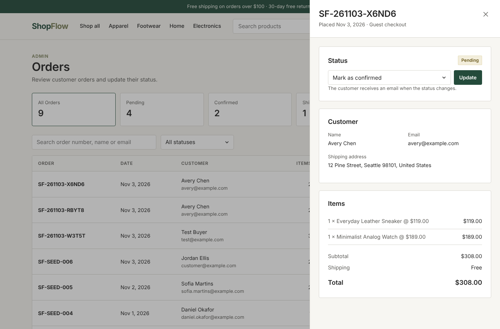
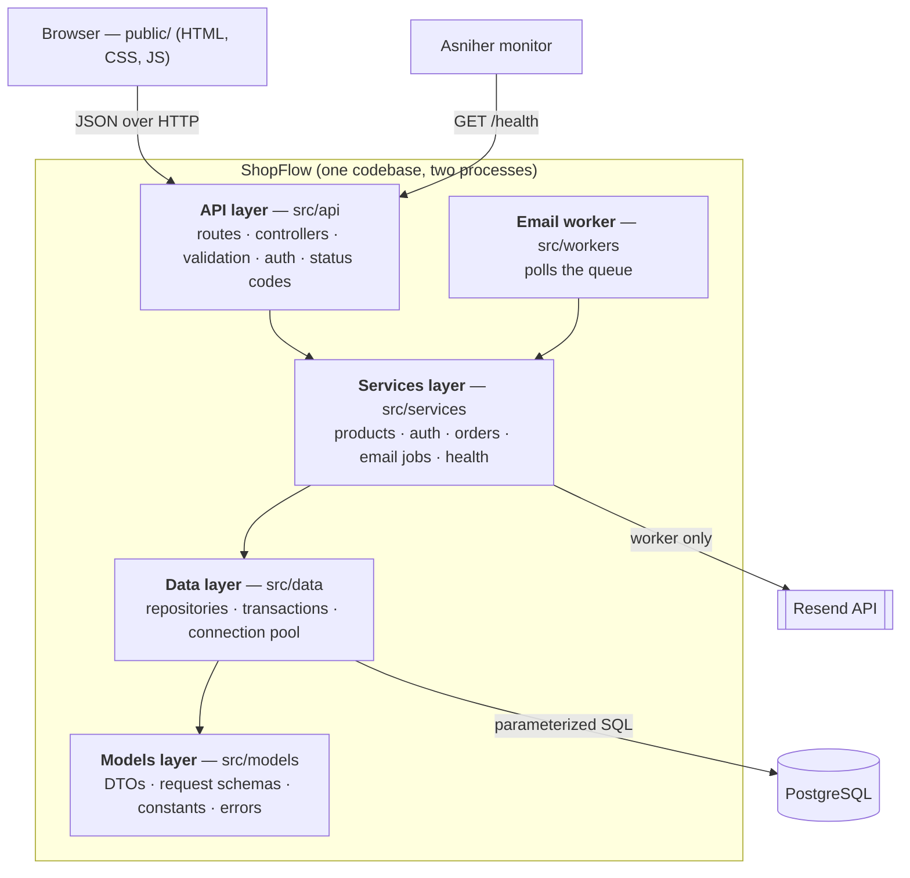
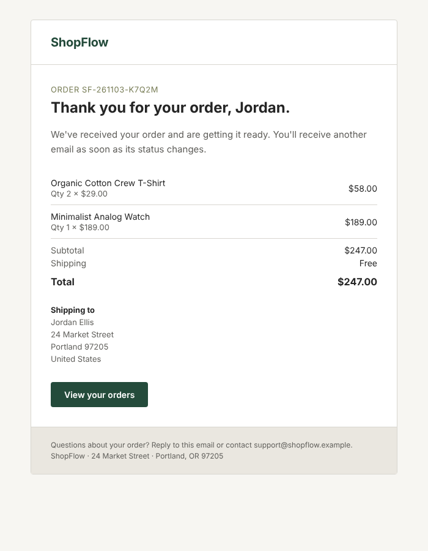
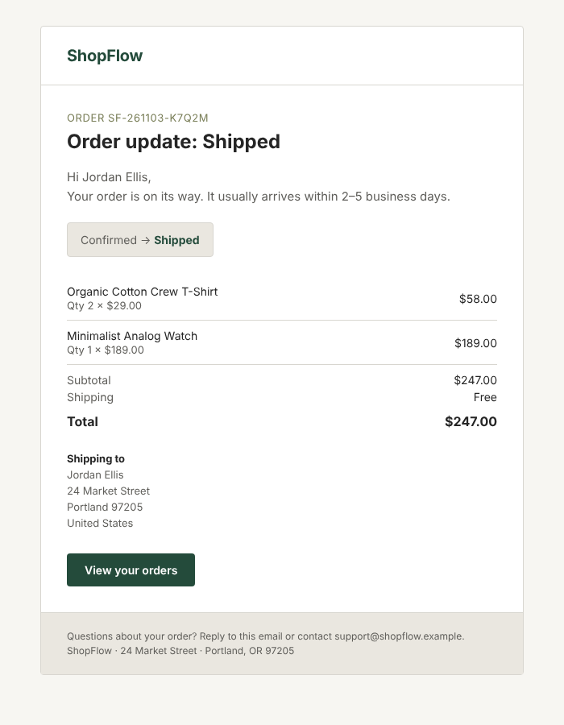

# ShopFlow — E-Commerce Order Management System

ShopFlow is a complete online store: a responsive storefront (home, catalog, product details, cart & checkout, login, customer account) plus an admin area for managing orders. It is backed by a **monolithic Node.js/Express API**, a **PostgreSQL** database and a **persistent email queue** whose background worker sends transactional emails through **Resend**.



---

## Table of contents

1. [Features](#features)
2. [Technology stack](#technology-stack)
3. [Project structure](#project-structure)
4. [Architecture](#architecture)
5. [Installation and setup](#installation-and-setup)
6. [Environment variables](#environment-variables)
7. [Database: migrations and seeding](#database-migrations-and-seeding)
8. [API reference](#api-reference)
9. [Email queue and retries](#email-queue-and-retries)
10. [Health check](#health-check)
11. [Testing](#testing)
12. [Deployment](#deployment)
13. [Monitoring (Asniher)](#monitoring-asniher)
14. [Security notes](#security-notes)

---

## Features

**Storefront**
- Home page with a hero banner, category tiles, bestsellers and a promo banner
- Product catalog with search by name, category and price filters, sorting (price, name, rating, newest) and a *Load more* button
- Product details with a quantity selector, stock status and related products
- Cart stored in the browser: change quantities, remove items, live totals (free shipping from $100)
- Checkout form (name, email, shipping address) → order submitted to the API → confirmation screen
- Sign in / create account with client-side validation and clear error messages
- "My orders" page for signed-in customers
- Loading skeletons, error states and a fallback when a product photo fails to load
- Responsive on desktop, tablet and mobile

**Admin**
- Orders table with counts per status, search (order number, name, email) and a status filter
- Order details drawer with customer, address, items and totals
- Status updates that follow a fixed workflow; cancelling puts the items back in stock

**Backend**
- Four-layer architecture (API → Services → Data → Models), checked by an automated test
- Checkout in a single database transaction with row locks, so stock is never oversold
- Order lines keep the product name and price at the time of purchase
- JWT authentication, bcrypt password hashing and role-based authorization
- Email jobs saved in PostgreSQL in the same transaction as the order, then sent by a background worker with retries
- `GET /health` reports app and database status (200 / 503)

## Technology stack

| Area | Technology |
| --- | --- |
| Runtime | Node.js 20+ (CommonJS) |
| Web framework | Express 5 |
| Database | PostgreSQL 14+ with the `pg` driver (parameterized queries, connection pool) |
| Authentication | `jsonwebtoken` (JWT), `bcryptjs` (password hashing) |
| Email | Resend (`resend` SDK), HTML templates written by hand |
| Configuration | `dotenv` + environment variables |
| Frontend | HTML, CSS and JavaScript (ES modules), no framework or build step, Inter font |
| Tests | Node's built-in test runner (`node:test`) + `supertest`, against a real PostgreSQL database |

There are only six runtime dependencies. Request validation is done by a small validator in `src/models/validation.js` rather than a library.

## Project structure

```
shopflow/
├── migrations/                 # Plain SQL migrations, applied in order
│   ├── 001_create_users.sql
│   ├── 002_create_products.sql      (categories + products)
│   ├── 003_create_orders.sql        (orders + order_items)
│   └── 004_create_email_jobs.sql
├── scripts/
│   ├── migrate.js              # npm run migrate
│   ├── seed.js                 # npm run seed
│   ├── seed-data/catalog.js    # sample categories and products
│   └── preview-emails.js       # renders email templates to docs/email-previews
├── src/
│   ├── api/                    # LAYER 1 — HTTP
│   │   ├── app.js              #   builds the Express app
│   │   ├── routes/             #   URL → middleware → controller
│   │   ├── controllers/        #   read request, call a service, send JSON
│   │   └── middleware/         #   validation, auth, rate limit, error handler
│   ├── services/               # LAYER 2 — business logic
│   │   ├── product.service.js
│   │   ├── auth.service.js
│   │   ├── order.service.js
│   │   ├── emailJob.service.js       (queue logic)
│   │   ├── emailDelivery.service.js  (Resend)
│   │   └── health.service.js
│   ├── data/                   # LAYER 3 — PostgreSQL
│   │   ├── db.js               #   pool, query(), withTransaction()
│   │   ├── migrator.js
│   │   └── repositories/       #   every SQL query lives here
│   ├── models/                 # LAYER 4 — shared definitions
│   │   ├── *.model.js          #   DTOs, request schemas, constants
│   │   ├── validation.js       #   schema validator
│   │   └── errors.js           #   AppError, NotFoundError, ...
│   ├── templates/              # HTML email templates (used by services)
│   ├── workers/emailWorker.js  # polling loop for the email queue
│   ├── config/index.js         # reads environment variables
│   ├── server.js               # entry point: web server
│   └── worker.js               # entry point: email worker
├── public/                     # Storefront (served by Express)
│   ├── index.html, products.html, product.html, cart.html,
│   │   login.html, account.html, admin.html, 404.html
│   ├── css/styles.css
│   └── js/
│       ├── api.js, cart.js, session.js, ui.js, layout.js, icons.js
│       └── pages/              # one script per page
├── tests/                      # node:test suites (real PostgreSQL)
├── docs/                       # screenshots and email previews
├── .github/workflows/ci.yml    # runs the tests on every push
├── render.yaml, Procfile       # deployment
├── .env.example
└── package.json
```

## Architecture

### The four layers



The same structure in plain text:

```
   Browser / Monitor
          │ HTTP
          ▼
 ┌──────────────────┐        ┌──────────────────┐
 │    API layer     │        │   Email worker   │   (separate process,
 │ routes, valid.,  │        │  polling loop    │    same codebase)
 │ auth, responses  │        └────────┬─────────┘
 └────────┬─────────┘                 │
          ▼                           ▼
 ┌─────────────────────────────────────────────┐
 │               Services layer                │──► Resend (worker only)
 │      business rules, transactions, queue    │
 └────────────────────┬────────────────────────┘
                      ▼
 ┌─────────────────────────────────────────────┐
 │                 Data layer                  │──► PostgreSQL
 │        repositories (all SQL), pool         │
 └────────────────────┬────────────────────────┘
                      ▼
 ┌─────────────────────────────────────────────┐
 │                Models layer                 │
 │    DTOs, schemas, constants, error types    │
 └─────────────────────────────────────────────┘
```

| Layer | Responsibility | Not allowed |
| --- | --- | --- |
| **API** (`src/api`) | Routes, request validation, auth middleware, HTTP status codes, JSON responses | SQL, business rules |
| **Services** (`src/services`) | Business logic (pricing, stock, status workflow, login), coordinating repositories inside transactions, queueing email jobs | `req`/`res`, SQL |
| **Data** (`src/data`) | Connection pool, transactions, every SQL query (parameterized) | Business decisions, HTTP |
| **Models** (`src/models`) | DTO mappers, request schemas, constants such as statuses and shipping rules, error classes | Imports from other layers |

**Dependency rule.** Each layer calls only the layer directly below it: API → Services → Data. Models is the foundation layer. It has no dependencies of its own, so any layer may import a schema, constant or error class from it without creating a cycle. `config/` holds settings and `templates/` holds pure rendering functions; neither imports anything from the layers. `tests/architecture.test.js` scans every `require()` and fails the build if a file breaks these rules or if SQL appears outside the data layer.

### Request flow example: placing an order

1. `POST /api/orders` → `order.routes.js` runs `optionalAuth` and `validate({ body: createOrderSchema })`.
2. `order.controller.create` calls `orderService.placeOrder(validatedBody, req.user)`.
3. Inside **one transaction**, the service:
   - locks the products (`SELECT … FOR UPDATE`), checks availability and stock, and reads the **current prices from the database** (prices sent by the client are ignored)
   - inserts the order and its items (name and price copied at the time of purchase)
   - reduces stock
   - inserts a **pending `order_confirmation` email job**
4. The transaction commits and the controller returns `201 Created`. No email is sent during the request.
5. The background worker later claims the job and sends it through Resend.

If any step fails (for example, not enough stock), the whole transaction rolls back: no order, no email job and no stock change.

### Database schema

```
users ─────────┐
  id PK        │ 1..n (nullable: guest checkout)
  email UNIQUE │
  role         ▼
            orders ───────────────┐             categories
              id PK               │ 1..n          id PK, slug UNIQUE
              order_number UNIQUE ▼                  │ 1..n
              status CHECK   order_items             ▼
              subtotal/shipping/total_cents      products
                               order_id FK         id PK, slug UNIQUE
                               product_id FK ───►  price_cents, stock CHECK >= 0
                               product_name, unit_price_cents (snapshot)

email_jobs (queue)
  id, recipient_email, email_type, payload JSONB, status, attempts, max_attempts,
  last_error, next_attempt_at, locked_at, locked_by, provider_message_id,
  created_at, updated_at, processed_at
```

- Money is stored as **integer cents** to avoid floating-point errors. The API returns decimal amounts.
- `CHECK` constraints enforce valid statuses, non-negative stock, `quantity > 0`, `line_total = unit_price × quantity` and `total = subtotal + shipping`.
- Indexes cover the common lookups: product category, price and name; order status, user, date and email; and partial indexes on `email_jobs` for pending and processing jobs.
- An `updated_at` trigger keeps timestamps current on every table.

## Installation and setup

### Prerequisites

- Node.js **20 or newer**
- PostgreSQL **14 or newer** (local install or Docker)
- A free [Resend](https://resend.com) account and API key (only needed to actually send emails)

### 1. Clone and install

```bash
git clone https://github.com/<your-user>/shopflow.git
cd shopflow
npm install
```

### 2. Create the databases

```bash
# Option A — local PostgreSQL
psql -U postgres -c "CREATE USER shopflow WITH PASSWORD 'choose_a_password';"
psql -U postgres -c "CREATE DATABASE shopflow OWNER shopflow;"
psql -U postgres -c "CREATE DATABASE shopflow_test OWNER shopflow;"

# Option B — Docker
docker run -d --name shopflow-pg -p 5432:5432 \
  -e POSTGRES_USER=shopflow -e POSTGRES_PASSWORD=choose_a_password -e POSTGRES_DB=shopflow postgres:16
docker exec shopflow-pg createdb -U shopflow shopflow_test
```

### 3. Configure the environment

```bash
cp .env.example .env
# then edit .env: DATABASE_URL, TEST_DATABASE_URL, JWT_SECRET, ADMIN_*, RESEND_API_KEY, EMAIL_FROM
```

### 4. Create tables and sample data

```bash
npm run db:setup        # = npm run migrate && npm run seed
```

### 5. Run the app

```bash
npm start               # web server  → http://localhost:3000
npm run worker          # email worker (second terminal)
```

During development you can use `npm run dev`, which restarts the server when files change. To run everything in one process, set `RUN_WORKER_IN_PROCESS=true`.

**Accounts after seeding**

| Role | Email | Password |
| --- | --- | --- |
| Admin | value of `ADMIN_EMAIL` | value of `ADMIN_PASSWORD` |
| Customer | `customer@example.com` | `Customer123!` |

## Environment variables

All configuration is read in `src/config/index.js`. The real `.env` file is git-ignored. Only `.env.example`, which contains placeholders, is committed.

| Variable | Required | Default | Description |
| --- | --- | --- | --- |
| `NODE_ENV` | no | `development` | `development`, `production` or `test` |
| `PORT` | no | `3000` | HTTP port |
| `APP_URL` | no | `http://localhost:3000` | Public URL, used for links in emails |
| `DATABASE_URL` | **yes** | – | PostgreSQL connection string |
| `DATABASE_SSL` | no | `false` | `true` for hosted databases that require TLS |
| `DATABASE_POOL_MAX` | no | `10` | Maximum pool connections |
| `TEST_DATABASE_URL` | for tests | – | Separate database that the tests **wipe** |
| `JWT_SECRET` | **yes** | – | Long random string used to sign tokens |
| `JWT_EXPIRES_IN` | no | `8h` | Token lifetime |
| `BCRYPT_ROUNDS` | no | `12` | Password hashing cost |
| `ADMIN_EMAIL` / `ADMIN_PASSWORD` / `ADMIN_NAME` | for seeding | – | Admin account created by `npm run seed` |
| `RESEND_API_KEY` | for the worker | – | Resend API key |
| `EMAIL_FROM` | for the worker | `ShopFlow <onboarding@resend.dev>` | Sender; must be on a domain verified in Resend |
| `EMAIL_REPLY_TO` | no | – | Reply-to address |
| `EMAIL_WORKER_POLL_INTERVAL_MS` | no | `5000` | How often the worker checks for jobs |
| `EMAIL_WORKER_BATCH_SIZE` | no | `10` | Jobs claimed per cycle |
| `EMAIL_MAX_ATTEMPTS` | no | `4` | Total attempts (1 + 3 retries) |
| `EMAIL_RETRY_BASE_DELAY_MS` | no | `30000` | First retry delay. Each later delay is 4× the previous one |
| `EMAIL_JOB_LOCK_TIMEOUT_MS` | no | `300000` | After this long, a job still marked "processing" is treated as abandoned |
| `RUN_WORKER_IN_PROCESS` | no | `false` | Run the worker inside the web process |

Generate a JWT secret with:
`node -e "console.log(require('crypto').randomBytes(48).toString('hex'))"`

## Database: migrations and seeding

```bash
npm run migrate   # applies new files from /migrations (tracked in schema_migrations)
npm run seed      # sample catalog, admin + demo customer, 6 sample orders
```

- Each migration runs in its own transaction, and applied files are recorded in `schema_migrations`, so running `npm run migrate` again is safe.
- The seed script is **idempotent**: categories and products are upserted by `slug`, users by `email`, and sample orders are only created when the `orders` table is empty. Sample orders do not create email jobs.
- The catalog contains 33 products in 6 categories (Apparel, Footwear, Accessories, Home & Living, Electronics, Beauty). Photos are loaded from Unsplash. If a photo cannot load, the storefront shows a neutral placeholder.

## API reference

All endpoints return JSON.

- **Success:** `{ "data": … }`, plus a `"meta"` object for lists.
- **Errors:** `{ "error": { "code": "…", "message": "…", "details": [ … ] } }`.

Authentication uses the header `Authorization: Bearer <token>`.

| Method | Path | Access | Description |
| --- | --- | --- | --- |
| GET | `/health` | public | App + database health |
| GET | `/api/products` | public | List products (filters, sorting, pagination) |
| GET | `/api/products/:id` | public | Product details |
| GET | `/api/products/:id/related` | public | Up to 4 products from the same category |
| GET | `/api/categories` | public | Categories with product counts |
| POST | `/api/auth/register` | public | Create a customer account |
| POST | `/api/auth/login` | public | Sign in, returns a JWT |
| GET | `/api/auth/me` | signed in | Current user |
| POST | `/api/orders` | public (guest) or signed in | Place an order |
| GET | `/api/orders` | signed in | Customers: their own orders. Admins: all orders |
| GET | `/api/orders/:id` | signed in | Order details (customers can only see their own) |
| PATCH | `/api/orders/:id/status` | **admin** | Change the order status |

### Status codes

| Code | When |
| --- | --- |
| 200 / 201 | Success / resource created |
| 400 `VALIDATION_ERROR`, `INVALID_JSON` | Invalid input (`details` lists each field) |
| 401 `UNAUTHORIZED` | Missing, invalid or expired token; wrong credentials |
| 403 `FORBIDDEN` | Signed in but not allowed (e.g. a customer changing a status) |
| 404 `NOT_FOUND` | Unknown resource or route |
| 409 `CONFLICT` | Out of stock, duplicate email, invalid status change |
| 429 `TOO_MANY_REQUESTS` | More than 20 login/register attempts in 15 minutes from one IP |
| 500 `INTERNAL_ERROR` | Unexpected error (details are logged, never returned) |
| 503 | `/health` when the database is unreachable |

### `GET /api/products`

Query parameters (all optional): `search`, `category` (slug), `minPrice`, `maxPrice` (dollars), `featured` (`true`/`false`), `sort` (`newest`, `price_asc`, `price_desc`, `name_asc`, `name_desc`, `rating_desc`), `page` (default 1) and `limit` (1–48, default 12).

```http
GET /api/products?category=footwear&maxPrice=120&sort=price_asc&limit=2
```

```json
{
  "data": [
    {
      "id": 9,
      "name": "Canvas Low-Top",
      "slug": "canvas-low-top",
      "description": "A vulcanised canvas sneaker with a padded collar…",
      "price": 65,
      "priceCents": 6500,
      "imageUrl": "https://images.unsplash.com/photo-…",
      "rating": 4.2,
      "reviewCount": 640,
      "stock": 120,
      "inStock": true,
      "isFeatured": false,
      "category": { "id": 2, "slug": "footwear", "name": "Footwear" }
    }
  ],
  "meta": { "page": 1, "limit": 2, "total": 3, "totalPages": 2 }
}
```

### `POST /api/auth/login`

```http
POST /api/auth/login
Content-Type: application/json

{ "email": "customer@example.com", "password": "Customer123!" }
```

```json
{
  "data": {
    "token": "eyJhbGciOiJIUzI1NiIsInR5cCI6IkpXVCJ9…",
    "user": { "id": 2, "name": "Jordan Ellis", "email": "customer@example.com", "role": "customer", "createdAt": "2026-11-03T13:40:00.000Z" }
  }
}
```

Wrong email or password → `401 { "error": { "code": "UNAUTHORIZED", "message": "Invalid email or password" } }`. The message is the same in both cases, so the response does not reveal which emails have accounts.

`POST /api/auth/register` takes `{ "name", "email", "password" }`. The password needs at least 8 characters. It returns `201` with the same shape as login, or `409` if the email is taken.

### `POST /api/orders`

```http
POST /api/orders
Content-Type: application/json
Authorization: Bearer <token>        # optional — links the order to the account

{
  "customerName": "Avery Chen",
  "customerEmail": "avery@example.com",
  "shippingAddress": { "line1": "12 Pine Street", "city": "Seattle", "postalCode": "98101", "country": "United States" },
  "items": [ { "productId": 7, "quantity": 1 }, { "productId": 12, "quantity": 1 } ]
}
```

`201 Created` (with a `Location: /api/orders/12` header):

```json
{
  "data": {
    "id": 12,
    "orderNumber": "SF-261103-X6ND6",
    "userId": null,
    "customerName": "Avery Chen",
    "customerEmail": "avery@example.com",
    "shippingAddress": { "line1": "12 Pine Street", "city": "Seattle", "postalCode": "98101", "country": "United States" },
    "status": "pending",
    "allowedNextStatuses": ["confirmed", "cancelled"],
    "items": [
      { "id": 20, "productId": 7, "productName": "Everyday Leather Sneaker", "productImageUrl": "…", "unitPrice": 119, "quantity": 1, "lineTotal": 119 },
      { "id": 21, "productId": 12, "productName": "Minimalist Analog Watch", "productImageUrl": "…", "unitPrice": 189, "quantity": 1, "lineTotal": 189 }
    ],
    "subtotal": 308,
    "shipping": 0,
    "total": 308,
    "createdAt": "2026-11-03T13:50:12.000Z",
    "updatedAt": "2026-11-03T13:50:12.000Z"
  }
}
```

Not enough stock → `409`:

```json
{
  "error": {
    "code": "CONFLICT",
    "message": "Some items in your cart are unavailable",
    "details": [ { "productId": 6, "message": "Everyday Pocket Tee is out of stock" } ]
  }
}
```

Invalid body → `400`:

```json
{
  "error": {
    "code": "VALIDATION_ERROR",
    "message": "The request contains invalid data",
    "details": [
      { "field": "customerEmail", "message": "customerEmail must be a valid email address" },
      { "field": "items[0].quantity", "message": "items[0].quantity must be at least 1" }
    ]
  }
}
```

Shipping costs $7.95, or is free when the subtotal is $100 or more. Duplicate lines for the same product are combined, and each item can have at most 20 units.

### `GET /api/orders`

Query parameters: `status`, `search` (order number, customer name or email), `page` and `limit` (max 100). For admins, `meta.statusCounts` gives the number of orders in each status:

```json
{
  "data": [
    { "id": 12, "orderNumber": "SF-261103-X6ND6", "customerName": "Avery Chen", "customerEmail": "avery@example.com",
      "status": "pending", "itemCount": 2, "total": 308, "createdAt": "…", "updatedAt": "…" }
  ],
  "meta": { "page": 1, "limit": 20, "total": 9, "totalPages": 1,
            "statusCounts": { "pending": 4, "confirmed": 2, "shipped": 1, "delivered": 1, "cancelled": 1 } }
}
```

### `PATCH /api/orders/:id/status` (admin)

```http
PATCH /api/orders/12/status
Authorization: Bearer <admin token>
Content-Type: application/json

{ "status": "confirmed" }
```

Returns `200` with the full updated order. Allowed transitions:

```
pending ──► confirmed ──► shipped ──► delivered
   │            │
   └────────────┴──► cancelled        (stock is returned)
```

Any other change returns `409`, for example `"Cannot change an order from pending to shipped"`. Every successful change queues an `order_status_update` email for the customer.

## Email queue and retries

The API **never** calls Resend. Emails go through a queue stored in the `email_jobs` table.

```
 HTTP request (POST /api/orders)            Background worker (npm run worker)
 ───────────────────────────────            ──────────────────────────────────
 BEGIN                                       every 5 s:
   insert order + items                        1. release stale jobs (crashed workers)
   reduce stock                                2. claim due jobs   ─── FOR UPDATE SKIP LOCKED
   INSERT email_jobs (status = pending)        3. for each job:
 COMMIT                                             render template → send with Resend
 return 201  ◄── user gets a fast response          ├─ ok    → status = sent, processed_at
                                                    └─ error → attempts < max ? pending + delay
                                                                             : failed
```

**Job lifecycle**

```
pending ──claim──► processing ──success──► sent
   ▲                   │
   └── retry (delay) ──┤ error and attempts left
                       └── error, no attempts left ──► failed
```

**How each requirement is met**

| Requirement | Implementation |
| --- | --- |
| Job saved only if the order is saved | `enqueueEmail()` runs in the **same transaction** as the order (transactional outbox) |
| No email during the HTTP request | Only `src/workers` calls `emailDelivery.service.js` |
| Job fields | `id`, `recipient_email`, `email_type`, `payload` (JSONB with everything the template needs), `status`, `attempts`, `max_attempts`, `last_error`, `created_at`, `updated_at`, `processed_at`, plus `next_attempt_at`, `locked_at`, `locked_by` and `provider_message_id` |
| At least 3 retries | `EMAIL_MAX_ATTEMPTS=4`, meaning 1 attempt + 3 retries |
| Reasonable delay between attempts | Exponential backoff: 30 s → 2 min → 8 min (`next_attempt_at`) |
| No two workers process the same job | Jobs are claimed in a single `UPDATE … WHERE id IN (SELECT … FOR UPDATE SKIP LOCKED)`. Rows locked by another worker are skipped |
| Worker crashes | A job left in `processing` for longer than `EMAIL_JOB_LOCK_TIMEOUT_MS` goes back to `pending`, or to `failed` if it has no attempts left. Updates check `locked_by`, so a slow worker cannot overwrite a job that was given to another worker |
| Duplicate sends after a crash | Each request to Resend carries the idempotency key `shopflow-email-job-<id>`, so Resend will not send the same job twice |
| Temporary Resend or database failures | Resend errors are caught and scheduled for retry. An error in one worker cycle is logged and the loop continues. On `SIGTERM` the worker finishes its current batch before exiting |
| Broken payloads | A template that cannot render fails immediately with no retries |

**Templates** live in `src/templates/`. They use table-based layouts with inline styles in the brand colours and include a plain-text version for every email. Run `node scripts/preview-emails.js` to write previews to `docs/email-previews/`.

| Order confirmation | Status update |
| --- | --- |
|  |  |

To test with Resend, use `EMAIL_FROM=ShopFlow <onboarding@resend.dev>`. Without a verified domain, Resend only delivers to your own account email. Place an order with that email address and watch the worker log.

To inspect the queue:

```sql
SELECT id, email_type, recipient_email, status, attempts, last_error, next_attempt_at
FROM email_jobs ORDER BY id DESC LIMIT 20;
```

## Health check

`GET /health` runs `SELECT 1` against PostgreSQL with a 3-second timeout.

Healthy → **200**:

```json
{
  "status": "ok",
  "timestamp": "2026-11-03T13:43:11.815Z",
  "uptimeSeconds": 5321,
  "checks": {
    "app": { "status": "up" },
    "database": { "status": "up", "latencyMs": 2 }
  }
}
```

Database unreachable → **503**:

```json
{
  "status": "error",
  "timestamp": "2026-11-03T13:45:00.000Z",
  "uptimeSeconds": 5410,
  "checks": { "app": { "status": "up" }, "database": { "status": "down" } }
}
```

The response is sent with `Cache-Control: no-store`. It never includes connection strings, hostnames or error messages, and a test checks this.

## Testing

```bash
npm test
```

The tests use a **real PostgreSQL database** (`TEST_DATABASE_URL`), which is dropped and re-migrated for each test file. Email delivery is replaced with a test function, so no real emails are sent. All other parts are the real implementation.

| File | Covers |
| --- | --- |
| `tests/validation.test.js` | Validator, order status workflow, shipping rule |
| `tests/orders.test.js` | Checkout pricing from the DB, stock reduction, price snapshots, rollback on conflicts, concurrent checkouts that cannot oversell, authorization, admin filters, status transitions, restocking on cancel, status-update email jobs |
| `tests/emailQueue.test.js` | Send → sent, retry with backoff → failed after 4 attempts, succeed on retry, no double claiming by 4 concurrent workers, recovery of crashed jobs, permanent failure for unrenderable jobs, worker processing a real checkout job, HTML escaping in templates |
| `tests/health.test.js` | 200 when healthy, 503 with no leaked credentials when the DB is down, recovery |
| `tests/productsAuth.test.js` | Product filters, sorting, pagination and 404s; categories; register/login/me; forged and expired tokens; JSON error format |
| `tests/architecture.test.js` | Layer dependency rules and "no SQL outside the data layer" |

GitHub Actions (`.github/workflows/ci.yml`) runs the suite against a PostgreSQL 16 service container on every push.

## Deployment

ShopFlow runs as two processes from one codebase: the web server (`npm start`) and the worker (`npm run worker`). Any Node host with PostgreSQL works.

### Render (blueprint included)

1. Push the repository to GitHub.
2. In Render, choose **New → Blueprint** and select the repository. `render.yaml` creates:
   - a PostgreSQL database `shopflow-db`
   - the web service `shopflow-web`, which runs migrations before each deploy and uses `/health` as its health check path
3. Fill in the secret variables in the dashboard: `APP_URL` (e.g. `https://shopflow-web.onrender.com`), `RESEND_API_KEY`, `EMAIL_FROM`, `ADMIN_EMAIL` and `ADMIN_PASSWORD`. `JWT_SECRET` is generated automatically.
4. After the first deploy, open the service **Shell** and run `npm run seed`.
5. Free plan: `RUN_WORKER_IN_PROCESS=true` runs the worker inside the web service. Paid plan: uncomment the `worker` service in `render.yaml` and set `RUN_WORKER_IN_PROCESS=false`.

### Railway, Fly.io or a VPS

- Provision PostgreSQL and set `DATABASE_URL` (plus `DATABASE_SSL=true` if the provider requires TLS).
- Release/start command: `npm run migrate && npm start`. Add a second process with `npm run worker` (see `Procfile`).
- Configure the platform's health check as `GET /health`, expecting status 200.

### Production checklist

- [ ] `NODE_ENV=production`, strong `JWT_SECRET`, strong `ADMIN_PASSWORD`
- [ ] `EMAIL_FROM` uses a domain verified in Resend
- [ ] `APP_URL` set to the public URL (used in email links)
- [ ] Worker running (separate process or `RUN_WORKER_IN_PROCESS=true`)
- [ ] Monitor configured on `/health` (see below)

## Monitoring (Asniher)

After deploying, create an HTTP monitor in Asniher for the health endpoint:

| Setting | Value |
| --- | --- |
| Monitor type | HTTP(S) |
| URL | `https://<your-deployment>/health` |
| Method | `GET` |
| Check interval | 1–5 minutes |
| Expected status | `200` (any other status, including `503`, counts as down) |
| Optional keyword check | response body contains `"status":"ok"` |
| Timeout | 10 seconds |
| Alerts | email to the project owner |

**Monitor screenshot**


> **To do before submission:** deploy the app, configure the monitor and save a screenshot showing the monitor and its status as `docs/images/asniher-monitor.png`. The image above will appear once that file exists.

To check that the monitor detects an outage, temporarily point `DATABASE_URL` at a stopped database. `/health` returns `503`, and the monitor should report the service as down.

## Security notes

- Passwords are hashed with bcrypt (12 rounds by default). Password hashes never appear in API responses.
- JWTs are signed with `JWT_SECRET`. A user who is deleted after a token was issued is rejected.
- Login returns the same error message, and takes about the same time, whether or not the email exists.
- Every SQL statement uses `$1, $2…` parameters. Sort options are chosen from a whitelist, so user input is never inserted into the SQL text.
- Order prices are always calculated on the server.
- Customers can only read their own orders. Another customer's order returns `404`, not `403`, so order IDs are not revealed.
- Status changes require the `admin` role.
- Login and register are rate limited.
- Security headers are set (`nosniff`, `DENY` framing, a strict referrer policy), `x-powered-by` is disabled and the JSON body size is capped at 100 kB.
- The frontend escapes all API data before inserting it into HTML, and the email templates escape all customer-provided text.
- No secrets are committed: `.env` is git-ignored and `.env.example` contains placeholders only.
